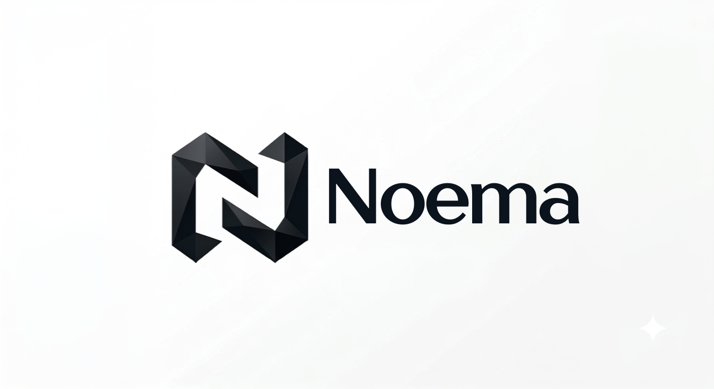

<div align="center">



# Noema

### Convert text into compact logical form: fewer tokens, no lost context, built for RAG

Noema is a Python library for **token-efficient RAG**. It turns documents into a deduplicated
**knowledge graph** and sends your LLM only the facts a question needs, in a compact notation.

[](https://pypi.org/project/noema/)
[](LICENSE)
[](pyproject.toml)
[](https://github.com/astral-sh/ruff)

</div>

---

## What is Noema?

**Noema** is a Python library for knowledge graph construction, LLM context compression and
Retrieval-Augmented Generation (RAG). Instead of treating documents as flat strings, it parses
text into a structured logical form of **entities, relations and events**, and organizes that
structure into a canonical, deduplicated graph.

At query time, only the sub-graph relevant to the question is rendered as a short,
line-oriented notation and placed in the prompt. The same compact representation that reduces
token usage is also the retrieval layer, so **token savings and retrieval quality come from
one design** rather than two systems bolted together.

```
Larry Page founded Google in 1998. Sundar Pichai is the CEO of Google.

        becomes

#1 Larry Page :PERSON
#2 Google :ORG
#3 Sundar Pichai :PERSON
#1 -found-> #2
#3 -ceo_of-> #2
```

A typical RAG pipeline stores and re-embeds raw text chunks. Noema stores canonical facts,
merges repeated mentions of the same fact into one node, and checks its compact notation by
decoding it back to natural language and scoring the result (round-trip validation).

## Why Noema? How it differs from other approaches

| | Plain-text RAG (chunk and embed) | Text-only prompt compressors | Noema |
|---|---|---|---|
| What is stored | Raw text chunks | Nothing (stateless) | Canonical, deduplicated facts |
| Multi-hop questions | Weak | Not applicable | Graph traversal connects facts across documents |
| Same fact in many documents | Repeated in every retrieval | Not addressed | Merged into one node |
| Context sent per query | Whole chunks | The compressed prompt | Only the relevant sub-graph |
| Meaning-loss check | None | Text similarity | Round-trip validation with a confidence score |
| Adding documents | Re-chunk and re-embed | Not applicable | Merges into the existing graph |

## Features

- **Text to semantic graph**: entity, relation and event extraction with optional coreference resolution
- **Canonicalization and deduplication**: one canonical node per fact, across one document or many
- **Compact notation**: a low-token representation for LLM context injection, decodable back to natural language
- **Hybrid retrieval**: vector similarity search plus multi-hop graph traversal, under a `max_tokens` budget
- **Round-trip validation**: a confidence score for how much meaning the notation keeps
- **Incremental knowledge base**: new documents merge into the existing graph; save and load as a single `.noema` file
- **Streaming ingestion**: batched ingestion with checkpoints for large document sets
- **Persistent backends**: optional Neo4j and RDF stores for larger knowledge bases
- **Framework integrations**: LangChain and LlamaIndex retrievers, plus OpenAI and Anthropic token counting
- **Command-line tool**: `noema` for compression, graph building, querying and inspection
- **Benchmark suite**: reproducible comparison against plain-chunk RAG and full-context stuffing

## Quick look

```python
import noema

kb = noema.KnowledgeBase()
kb.ingest(documents)
context = kb.retrieve("Who is Google's CEO?", max_tokens=200)

prompt = f"{context.text}\n\nQuestion: Who is Google's CEO?"
```

## Use cases

- Cutting LLM token costs in RAG pipelines and long-context applications
- Multi-hop question answering over facts spread across several documents
- Building a lightweight knowledge graph from text without hand-written schemas
- Keeping a knowledge base up to date as new documents arrive

## Documentation

Installation, usage guides, CLI and integration docs are on the project Wiki.

## Project status

Noema is under active development. The core pipeline, storage, retrieval, integrations, CLI
and benchmark suite are implemented; the public API may still change before 1.0.

## License

Noema is licensed under the [Apache License 2.0](LICENSE).

<sub>Keywords: RAG, retrieval-augmented generation, knowledge graph, GraphRAG, LLM context
compression, prompt compression, token reduction, semantic compression, entity and relation
extraction, multi-hop question answering, LangChain, LlamaIndex, Neo4j, RDF, Python.</sub>